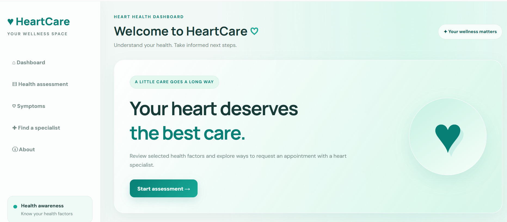
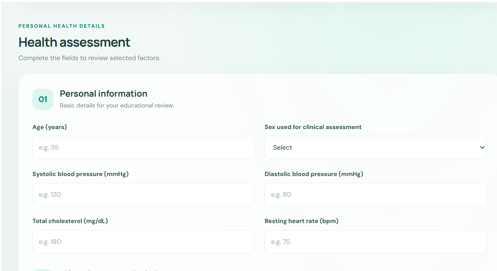
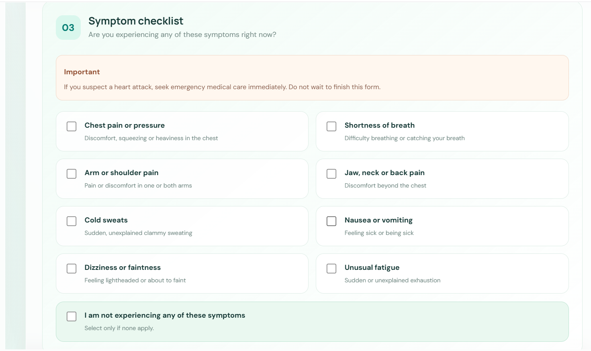
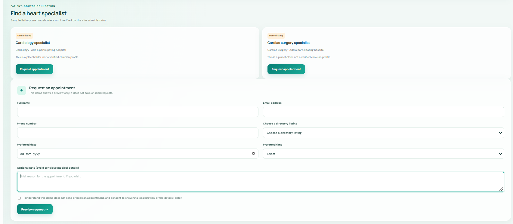

# Heart Attack Detection

A heart care health dashboard website built using HTML, CSS, and JavaScript.

## Technologies Used
- HTML
- CSS
- JavaScript

## Project Files
- index.html
- style.css
- app.js

## Purpose
This project provides a web-based interface for a heart health dashboard.

## 📸 Website Screenshots

### 1. Home Page

### 2. Health Assessment

### 3. Symptoms

### 4. Find a Specialist

### 5. Lifestyle and Medical History

## 🌐 Live Demo

[**Visit the HeartCare Website**](https://rakshitamahesh.github.io/Heart-attack-detection/)
